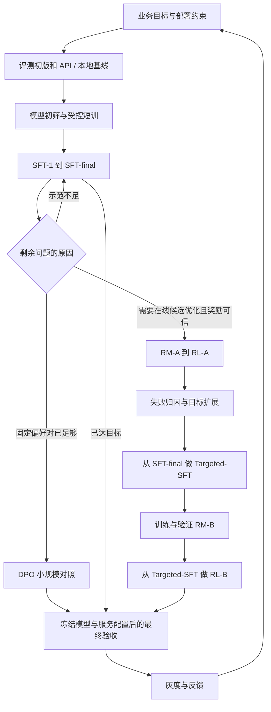

# Character-RLHF 完整完善方案：主线、阶段对齐、模型选型与训练部署适配

日期：2026-11-08。用途：供后续工作模型改写面试资料、组织实验设计及验收；本文是整合方案，不是新增训练结果报告。

**核心判断：保留“基础 SFT → RM-A / RL-A → 定向 SFT → RM-B / RL-B”的双阶段主线，把模型选型、阶段交接、独立评测和部署验收补成一条可解释、可验证的决策链。** 当前 Gemma 路线可以作为工作选择，但不能在缺少公平对照时写成已证明最优；合理的新设计可以进入面试资料，不要求当前源码逐项实现。

本次交付为独立方案。原有正文、PDF、历史记录及训练代码保持原样。下文的文件修改表是后续实施范围建议，交给工作模型时应同时说明本次实际授权修改哪些文件。

## 1. 北极星、范围和交付标准

最终目标：面试时能够连续解释“业务为什么需要训练 → 为什么选择这个模型与方法 → 数据和信号怎样形成 → 实验怎样区分原因 → 结果能证明什么 → 如何交付部署 → 失败后回到哪里”。

当期切片：整理一套逻辑闭合、数值口径一致、能够据此实施实验的工作方案。真实训练和部署由实际资源与授权决定，不能把跑完所有实验变成编写学习资料的前提。

工作模型应使用四种口径，按章节或表格标注即可：

| 口径 | 可以写什么 | 不能据此推出什么 |
| --- | --- | --- |
| 历史实跑 | 有对应运行记录、产物和评测支持的经历 | 配置文件单独不能证明执行和效果 |
| 当前设计 | 准备采用的初始化、数据、算法、服务与实验方案 | 不能用“实现了／提升了”替代待验证假设 |
| 口述口径，待对账 | 用户提供但尚未完成底层对账的数字或经历 | 用户确认不等于实验独立验证 |
| 教学演练 | 明确输入、假设、公式和用途的预算或算例 | 不能作为模型优劣、显著性或上线效果证据 |

允许面试材料包含未实现但合理的设计；同时保证“做过什么”和“下一步如何改进”能清楚区分。对暂时不确定的选择，写出最小验证方法和改变判断的条件。

### 1.1 当前应优先处理的问题

| 优先级 | 本轮核对到的现状 | 不处理的影响 | 本方案处置 |
| --- | --- | --- | --- |
| P0 | [附件母版 §1.10](Character-RLHF_附件母版完善稿.md) 直接指定 Gemma 与训练配置 | 缺少选择与淘汰候选的依据 | 增加受控选型和部署可行性路线，见 §4 |
| P0 | [历史 overview 的 SFT 表](../character-rlhf/docs/project_chatjoy_overview.md) 同时改变模型、rank、cutoff 与训练环境 | 不能从 loss 高低归因模型优劣 | 历史记录与新公平对照分开，跨 tokenizer 不按 loss 排名 |
| P0 | [Benchmark 专题](技术分层/01_Benchmark制作与指标计算_Judge一致性技术分层.md) 写 B6=750，附件母版写 B6=800 | 分母、配额和结果解释冲突 | 本方案以附件母版的 800 作为待修订设计基线，见 §3、§9 |
| P0 | 旧合同仍保留“SFT 打顶再 RL”等线性叙述 | 把项目倾向写成算法前提 | 改为按能力覆盖、信号可信度与边际收益选择下一步 |
| P0 | RM 离线使用 raw history，RL 在线使用 summary | 排序与标签可能因输入改变而失效 | 增加相同候选的上下文对照，见 §3.3 |
| P0 | 同一 SR 多次参与 checkpoint 选择 | 容易把开发集写成独立测试 | 明确 Dev、阶段验收、Final-Test 的不同用途 |
| P0 | 已有[试用服务指南](../character-rlhf/docs/runbooks/rl_v610_step90_service_guide.md)，但训练交付与部署职责没有连成主线 | 容易混淆 rollout、RM 服务和产品服务 | 建立交付配置、服务配置及联合验收，见 §10 |
| P1 | Conditioned KL、Span 等机制出现在部分材料 | 容易把复杂度当成改进，或把组合收益归因某一机制 | 先统一最小训练主线，再按失败证据决定是否增加，见 §8 |

这些是技术与叙事质量问题，不表示用户目标需要调整。当前最小下一步是统一主账、初始化与评测用途，再按文件表改稿。

## 2. 主线如何重写：按决策组织，不按版本流水账组织

### 2.1 推荐叙述

ChatJoy 要解决的是多语言角色互动中的语言一致、角色贴合和连续对话质量。先比较现有 API＋prompt、可本地部署模型和小模型方案；对无法仅靠 prompt 稳定解决的问题构造 SFT 数据。基础行为建立后，检查剩余错误更适合补示范、直接偏好优化还是在线奖励优化。

早期 RM-A 主要覆盖角色、语言与长度等较显式的偏好。如果 RL-A 暴露表达不足、破角或规则奖励方向错误，应分别检查 Actor 是否能生成合格回答、RM 是否能排对、规则是否改变了正确排序、评测与线上输入是否一致。针对已定位的缺口，用 Targeted-SFT 补行为，用 RM-B 补偏好覆盖，再判断是否值得进入 RL-B。

最终用实际服务形态验收 Actor，将模型版本、输入协议、生成配置和部署条件一起交付。线上发现的新问题回到数据、评测、奖励、优化或服务环节，而不是默认继续加训练步数。

历史复盘保留目标演进顺序：如果抗破角与丰富度是第一阶段以后才被明确，不倒写成一开始就完成了同样的实验设计。当前改进方案可以前置这些检查，但应标明这是现在提出的改进。

### 2.2 主流程与分支



RM/RL 不是所有项目都要经过的关卡；主线记录本项目的方案选择，分支用于说明为何不选其他方法。若 SFT 或 DPO 已满足目标，应允许在那里结束训练路线。

### 2.3 与通用十阶段 pipeline 的对应

每个阶段均按“问题 → 输入输出 → 理由 → 通过／停止／可跳过条件 → 失败去向”写正文：

| 阶段 | 问题与输入输出 | 选择理由 | 通过、停止或可跳过条件 | 失败后的去向 |
| --- | --- | --- | --- | --- |
| 1 业务与基线 | 真实失败样本、成本和体验约束 → 指标、护栏、初版评测 | 明确训练值得解决的问题 | 目标可测、基线可比较；不跳过 | 重新限定业务问题或评测 |
| 2 选型与初步路线 | 候选模型、部署预算 → 候选短名单与 SFT/DPO/RL 假设 | 提前排除不可行投入 | 至少有小规模比较；正式选型由阶段 6 确认 | 调模型大小、部署假设或路线 |
| 3 数据与环境 | 训练来源家族、失败分类 → 数据与隔离清单 | 数据应覆盖目标行为 | 单位、标签、长度和隔离清楚 | 修来源、构造、模板或资源 |
| 4 信号与约束 | 示范／偏好对／奖励规则 → 可解释训练目标 | 明确到底鼓励了什么 | 关键反例方向正确；不跳过 | 修数据、RM、规则或 Judge |
| 5 冒烟 | 小批数据、配置 → 梯度、mask、保存重载与评分检查 | 验证链路正确 | 关键接口通过；不以此证明效果 | 修实现或接口 |
| 6 小规模试验 | 受控对照 → 模型、方法、超参及预算选择 | 区分竞争解释 | 有效果、稳定性与成本依据；不跳过 | 补最有区分力的实验或停止 |
| 7 正式训练 | 选定方案 → checkpoint 与 Dev 曲线 | 扩大已验证的投入 | 按 Dev、护栏和预算停止；课程学习可选 | 回阶段 3/4/6 |
| 8 阶段及最终验收 | 锁定版本 → 配对结果、切片和结论范围 | 避免训练指标替代业务效果 | 阶段开发与独立测试分别命名 | 保留基线、归因；不围绕同一 test 反复调参 |
| 9 坏例归因 | 失败样本与对照 → 下一步决策 | 防止无效加数据、加步骤 | 指向可检验原因；贯穿各阶段 | 按问题返回相应阶段 |
| 10 交付与反馈 | 模型包＋服务配置 → 灰度、回滚、反馈 | 确认用户实际得到的效果 | 质量与服务条件联合达标；未实施就明确写设计 | 回服务、输入、数据或训练 |

## 3. 先统一跨阶段主账与交接

以下采用附件母版的双阶段方案作为改稿工作基线，不把它升级为已核验历史。若后续改变某项设计，联动更新本节和依赖它的正文。

### 3.1 模型初始化、数据与训练对象

| 阶段 | 初始化／固定对象 | 当前设计的数据账 | 训练输出 | 进入下一阶段前要看什么 |
| --- | --- | --- | --- | --- |
| 模型选型 | 精确候选模型及 revision | 公共的短训子集、Selection-Dev | 暂定 Actor 底座 | 业务质量、短训适应、工程及部署成本 |
| SFT-1 | 选定的 IT/Instruct 模型 M0 | 2,780 Group × 6 = 16,680 个监督回答 | SFT-1 Actor | 语言、角色、承接与格式 |
| SFT-final | 从 SFT-1 继续 | 完整 3,780 Group × 6 = 22,680 个监督回答，含原 2,780 | SFT-final Actor | 相对 SFT-1 的收益与退化；不只看 loss |
| RM-A | SFT-final backbone＋新 scalar head | 10,000 Pair；Role 3,000、Language 3,000、Short 2,000、Long 2,000 | RM-A | 排序、分切片误差及在线候选区分能力 |
| RL-A | Actor=SFT-final；Ref=冻结 SFT-final；RM-A 固定 | 3,200 个唯一训练 Prompt；每 Prompt G=6 | RL-A Actor | 相对 Step0 的生成质量与失败类型 |
| Targeted-SFT | 从 SFT-final 初始化，RL-A 用于发现问题 | 2,400 Group：Retention 1,200、Richness 600、Defend 600；共 14,400 个监督回答 | Targeted-SFT Actor | 补短板且守住相对 SFT-final 的旧能力 |
| RM-B | Targeted-SFT backbone＋新 scalar head；默认不是继续训练 RM-A head | 30,000 Pair：旧 Anchor 9,000＋新 Clean 15,000＋新 Attack 6,000 | Unified RM-B | Core 保留、Clean/Attack 排序及在线输入适配 |
| RL-B | Actor=Targeted-SFT；Ref=冻结的同一 Targeted-SFT；RM-B 固定 | 3,200 Prompt：Clean 2,240＋Attack 960；G=6 | RL-B Actor | 相对 Targeted-SFT 的增益，以及相对 SFT-final 的长期保留 |
| 产品服务 | 通过最终验收的 Actor | 真实角色卡、历史处理与用户请求 | 流式回复 | 部署形态下质量、延迟、成本与稳定性 |

必须讲清的理由：

- Targeted-SFT 从 SFT-final 重启，是为了在一个已知基础上补行为，并避免默认继承 RL-A 的奖励捷径；这是一项设计取舍，不是所有项目的固定规定。若要选 RL-A 初始化，应另做同数据对照。
- RM-B 采用新 backbone＋新 head，是本方案起点；保留旧能力依赖 Anchor 回放和实际评测，不能靠“换了更好的 backbone”保证。继续 RM-A 训练是可比较的替代方案，不同时混写。
- Ref 是当期 RL 的固定参照，RM 是奖励评分器，两者用途不同。RM-A/B 的 raw score 不能直接横向比较均值来解释进步。
- 2,400 Group 已包含 1,200 个 Retention 记录；30,000 Pair 已包含 9,000 个 Anchor，不再额外相加。
- SFT-final 继续训练会重复暴露旧数据。去重数据量、累计样本暴露、监督 token 暴露必须分别统计。

### 3.2 单位与版本

| 单位／名称 | 定义与使用边界 |
| --- | --- |
| Group | 一个多轮训练记录，本设计有六个目标 assistant 回答；不自动等于独立生产会话 |
| Prompt | 一次决策时模型实际看到的完整条件；可从一个 Group 的不同 turn 构造 |
| Response | 一次生成的候选回答；重复采样不增加独立题目数量 |
| Pair | 同一个 Prompt 下的两条回答及偏好方向；10,000 Pair 有 20,000 个回答槽位，不保证有 20,000 条唯一文本 |
| Scene | 固定角色、状态和当前请求的 Actor 评测题 |
| Family | 同源会话、场景、改写或攻击模板的归属；用于隔离和统计相关性 |
| RL iteration | 一批 Prompt 采样、评分和若干优化更新构成的外层循环 |
| optimizer update | 一次真正更新参数；与梯度累积 micro-step 分开 |
| SFT/RM/RL/产品版本 | 分别编号并记录 parent checkpoint；restart 计数不自动代表新算法版本 |

所有表格必须出现计数单位；“训练 3,200 条”“step100”这种缺少单位的表述应补齐。

### 3.3 Raw、Summary 与部署输入必须显式衔接

附件母版当前设计：SFT 主要学习完整多轮轨迹；RM 离线 Pair 使用 raw history；RL 在线 Actor 与 RM 均使用 `Role Card＋History Summary＋Current User`；SR 使用同一 summary 视图。

这是需要验证的分布差异，不是仅靠“Actor 与 RM 看见一样的输入”就已解决。建议先做三个低成本对照：

| 对照 | 固定什么、改变什么 | 看什么 | 失败后处理 |
| --- | --- | --- | --- |
| 摘要保真 | 同一原始状态，只比较 raw 与 summary 可见信息 | 身份、关系、承诺、事件是否遗漏／新增；是否混入未来答案 | 修摘要和输入规则 |
| RM 输入适配 | 同一 RM、同一对候选，仅替换上下文视图 | 排序翻转、Judge 标签是否仍成立、关键事实是否可见 | 事实保留但 RM 排错时，补适配数据或调整评分方案 |
| Actor 输入适配 | 同一 Actor、同一场景和解码协议，比较 raw 与 summary | 角色、承接、语言和攻击表现 | 分辨摘要问题与模型对输入格式不适应，必要时加入 summary 条件的监督数据 |

RM 对照可先用独立 Calibration 中 50 Pair（Clean 25、Attack 25）定位问题。双视图、双回答共 200 个评分槽位；这是诊断预算，不能证明全分布已经通过。

如果真实产品采用“摘要＋最近几轮”，应把它登记为新的输入协议版本，重新验证并同步到相关训练输入、SR 和交付说明；不能默默把附件母版的 summary-only 换成另一种格式。Actor 与 RM 可以使用各自的 tokenizer，但看到的业务事实及截断语义应对齐。

## 4. 模型选型：可以执行的工作路线

### 4.1 候选与前置约束

建议使用三个本地候选和一个产品基线：

| 对象 | 纳入理由 | 待检验假设 |
| --- | --- | --- |
| Gemma4-26B-A4B 的 IT 版本 | 当前方案的工作选择 | 在角色质量、适应成本与部署预算之间是否合适 |
| Qwen3-30B-A3B-Instruct-2507 | 同量级异家族、已有项目经验 | 是否能改善语言、角色或后训练性价比 |
| 较小模型，例如 Qwen3-8B | 成本对照 | 较大模型的增益是否值得额外资源 |
| 当前 API＋最佳已知 prompt | 产品基线 | 训练后相对现状究竟改善什么、损失什么 |

这是与本项目有关的候选集合，不是当前市场排名或穷举。精确权重、revision、IT/Base、模板、精度和思考模式必须登记。Qwen 30B 的 2507 Instruct 版是非思考版本；8B 可切换思考模式，比较时不能遗漏这个区别。[S1][S2][S3]

先从部署方取得：硬件／成本范围、典型输入输出长度、目标并发、首字与完整回复延迟要求、支持的推理栈。具体 GPU 张数与服务参数可在部署测试中确定；若尚不明确，填写“部署假设，待验证”，不凭空写成现有生产配置。

MoE 的激活参数量不是加载权重总量。用于规划的显存预算应包括实际权重、KV cache（解码时缓存的注意力键值）、运行工作区和余量；训练时还要考虑梯度、优化器等。纸面估算与硬件实测分别记录。

### 4.2 数据与比较协议

- Selection-Dev 可复用已明确作为开发用途的 SR 设计：Clean 200 Scene＋Attack 100 Scene。历史初始选型若尚无 Attack 目标，应分别写初始实验和后续扩展验证。
- 初筛可以用 Dev 的预先固定子集；正式比较使用完整 Dev。不能看模型回答后删掉它不擅长的题。
- 最终 Actor Test 另留来源家族，覆盖核心业务切片。样本量根据想检测的改善幅度与不确定性确定，不把 300 Scene 视为普遍充分的标准。
- 相同业务信息使用各自正确模板；核对角色、特殊 token、历史截断和结束标记。训练数据尽量保持相同语义覆盖，并记录不同 tokenizer 的长度与有效监督 token。
- 共同参考解码配置与实际服务候选配置分别报告。若模型需要专门解码调参，给同等搜索预算并在 Dev 上完成，不给一个模型更充分的优化机会。

### 4.3 实验漏斗

| 实验 | 操作与产出 | 通过／停止条件 | 下一步 |
| --- | --- | --- | --- |
| E0 运行可行性 | 加载、模板、长输入、生成、LoRA 小步训练、保存重载；得到资源记录 | 关键链路可运行且预算可接受；单纯环境配置错误先排除 | 进入原始能力对比或淘汰不可行候选 |
| E1 原始能力 | 三个本地候选＋产品基线在固定题上生成；记录失败切片 | 留下两个值得短训的候选；明确预期可修短板 | 受控短训 |
| E2 短训适应 | 相同数据、相同调参机会；比较绝对业务质量、收益和成本 | 关键护栏不退化，预算内有竞争力 | 暂定底座；接近时补独立样本或保留低成本方案 |
| E3 部署复核 | 导出／重载，使用拟部署精度、模板和上下文协议；做质量与性能测试 | 服务形态下的效果、资源、延迟同时可接受 | 正式训练；否则先修部署或重新选型 |
| E4 正式 SFT | 对选定底座扩大训练，Dev 选 checkpoint | 所选方案在目标规模达到质量、护栏与预算要求；不据此比较未扩训候选 | 进入方法选择或直接交付 |
| E5 最终确认 | 最终模型与服务配置锁定后评测 Final-Test | 达到预先定义的质量和服务要求 | 灰度；失败则登记后续轮次，不继续用同一 test 调参 |

E1 不把未微调表现当作后训练上限；短训排序也不能证明 RL 上限。对后续 RL 的最小兼容性在 E0 检查，不必给所有候选训练完整 RM/RL。只有未解决的路线分歧确实取决于 RL 表现时，再补有针对性的对照。

只扩训入选模型，能够验证该方案是否达标，不能证明短训时的候选排序在更大规模仍然成立。若要主张“扩大训练后仍优于次优模型”，需给关键次优候选对等的扩展预算；预算不支持时保留结论边界。正式训练明显偏离短训预期时，应重新打开选型或训练配置判断。

### 4.4 建议的第一轮短训预算

从训练池分层抽 512 个完整 Group，每组六个监督回答，共 3,072 个监督回答。两个候选各尝试两个学习率，例如 `5e-5` 与 `1e-4`，各一轮；每个候选的最佳 Dev 配置再换一个训练 seed 复跑。合计四次探索＋两次复跑＝六次短训，同时设 GPU 小时上限。

LoRA 可从 `r64/alpha128、q/k/v/o` 起步，但需核对实际模块和可训练参数量；rank 相同并不保证训练容量等价。每轮保存数据清单、mask 检查、长度处理、学习率、seed、token 暴露、耗时和显存。

这是一项启动预算，不保证统计充分，也不表示所有模型都能在一轮达到合适状态。记录学习曲线和是否明显欠训练；发现配置不适合某模型时，给对称的补充预算或限定结论，不能据此宣布模型家族更差。

分开回答两件事：同样数据暴露下谁更好；同样 GPU 小时或成本内谁更划算。跨模型不按训练 loss 排名，优先比较训练后绝对质量，再看相对自身起点的增益。

### 4.5 选型决策

先检查硬约束和关键护栏，再比较质量—成本取舍。主指标可用固定场景上的盲评偏好胜率 `(胜＋0.5×平)/总比较数`；同时分报语言、角色、承接、丰富度、密度、破角和生成失败。

在看结果前约定最小值得关注的收益、最大可接受退化、成本上限和追加样本预算。前文讨论过的 55% 胜率只能作为待校准门槛示例，不是行业标准。置信区间按 Scene／Family 成组计算，多 seed 和多解码配置不能当成独立新题。

当质量没有可辨别优势时，可以根据成本、兼容性和维护负担做工程选择；写成“在当前预算和评测下暂定采用”，不要补造显著领先结论。

## 5. 基础 SFT：保留数据工程深度，补上决策与接口

需要保留并讲清：真实 Session 重建、Head/Continuation、Teacher 因果生成、Pre/Post 检查、双 Judge、最多一次 Repair、assistant-only loss、长度分布与数据版本。速查版从完整正文派生，不能形成第二套数字。

具体修订要求：

1. Teacher 生成第 t 轮时只看当时可用的信息和已生成前缀，不混入未来答案；重写前轮后，要检查后续固定用户话语是否仍与新前缀相容，不相容的窗口应重构或剔除。
2. 历史可参与 attention，但只有预定的目标 assistant token 参与监督；prompt、padding 和只作为上下文的旧回答不自动计算 loss。
3. Cutoff 由完整轨迹的实际 token 分布和硬件 profile 确定。不能先截掉多轮再继续称“完整六轮”；超长处理规则在数据冻结前决定。
4. 保留 2,780→3,780 Group 作为当前设计主账，区分新增数据和继续训练量。不能把全部提升单独归因新增 1,000 Group，除非做等训练预算的数据对照。
5. Teacher API 失败、被拦截或不合格回答作为生产失败记录，不转成虚构的优质监督；数据质量过滤与正式 Actor 评测不同，正式评测不能修答案再计分。
6. 若目标部署使用摘要输入，在 §3.3 对照后决定是否需要适量加入同协议数据；不能只在服务端改格式而不验证。

SFT 验收至少看：相对 M0/SFT-1 的语言与角色改善、长历史承接、格式、信息密度、重复与目标回复长度。loss 下降是优化诊断，不是产品验收。

从 SFT 进入下一步的条件：目标行为已有一定覆盖，剩余问题可以由可信偏好／奖励信号区分，并且预期投入划算。不得写成“SFT 必须打到极限”；也不将“RL 只能放大已经存在的能力”写成普遍理论定律。这里的实际判断是：当合格候选极少、奖励信号稀疏或不可靠时，先补示范往往更值得验证。

## 6. RM-A 与第一次方法选择

### 6.1 Pair 与训练目标

RM-A 的设计从较显式的 Role、Language、Short、Long 差异入手。Short/Long 的偏好依据是缺失必要信息、冗余和低密度，不能仅凭长短定输赢。

构造 chosen/rejected 时保持同一 Prompt、角色卡和历史。即使 rejected 用错角色条件生成，送入 RM 的两侧也必须回到同一目标条件，否则改变了比较问题。Judge 分数、构对 heuristic、RM 输出、在线规则奖励分别命名。

采用单一实数评分头：

`r_phi(x, y) ∈ R`

`L_RM = -log sigmoid(r_phi(x, chosen) - r_phi(x, rejected))`

明确 EOS／最后有效 token 等取分位置、padding 和截断语义、score head 的训练与保存加载。scalar reward 不要求落在 Judge 的 1–5 分范围。[S4]

训练集目标 10,000 Pair，3,780 Group×四类错误最多给出 15,120 个候选 Pair 槽位；目标数量不能超过真实可提议且合格的唯一候选。Judge 差异阈值可在 Calibration 扫描，结果包括保留量、标签可靠性和切片损失，不能为凑数量放宽到无法判定。

### 6.2 RM 通过条件

不仅看总体 Pair Accuracy，还要看分类型正确率、近似同质候选上的区分能力、长度捷径、离群分数、不同语言表现和相同候选的 raw/summary 对照。

旧 A-Internal 250 Pair 用作开发；旧 B-RMBench 250 Pair 用作冻结阶段验收。benchmark 如果被反复用于改配置，就记录开发暴露，不继续称完全独立。

高准确率不自动证明能指导 RL。若考试主要是明显错语言／错角色，在线候选却大多形式正确，必须补测“都还不错的候选如何排序”。评分差小也不能直接推出无梯度，应结合组内标准化、epsilon、精度与排序正确性判断。

### 6.3 为什么不直接 DPO

应保留一个最小方法对照：同一 SFT 起点，比较不更新、继续 SFT、DPO；当在线奖励已通过验证且预算允许时，加入短程 RM-guided RL。DPO 用固定偏好对直接更新策略，标准离线训练不需要另训练一个显式 RM；它仍需可靠偏好数据、参考策略和独立评测。[S4]

不同方法不要求完全相同的数据形式，但需要相同业务分布、可比较的调参机会和分项成本账。若同时换数据、模型和方法，只能比较完整方案，不把差异归因某一算法。

选择在线 RL 的合理理由是：需要在当前策略产生的新候选上持续优化，已有可信在线评分，并且收益足以承担采样、RM 和工程成本。不能仅因为项目叫 RLHF 就跳过较简单方案。

## 7. RL-A → Targeted-SFT → RM-B：用失败解释阶段变化

### 7.1 先定位失败，不用版本号代替原因

| 观测 | 竞争性解释 | 最小区分办法 | 优先动作 |
| --- | --- | --- | --- |
| 回答干瘪 | Actor 不会写、RM 不会选、长度规则抑制表达 | 固定 Prompt 多候选，人工／Judge 与 RM 排序对照 | 补示范或修 RM／规则 |
| 破角增加 | RM 缺少攻击偏好、拒绝规则误伤防御、数据分布变了 | 同候选拆开 RM raw 与各规则项 | 修责任项，避免默认多训 |
| Reward 升、业务分不升 | 奖励捷径、Judge 偏置、Dev 过拟合 | 固定候选重评分、人工锚点、独立切片 | 修评价与训练信号 |
| 服务端退化 | 错底座、错模板、摘要缺事实、量化或解码差异 | 同权重逐项替换输入／运行条件 | 先修交付和服务 |

### 7.2 固定候选检查奖励方向

附件母版用于解释 A 阶段问题的公式是：

`R_A_example = r_A - 0.5 × format_fail - 1.0 × generic_refusal_hit`

这是失败机制示例，不要求新工作模型专门跑一遍错误奖励来补历史。若合格的角色内防御被误识别为 generic refusal，最终奖励可能低于破角回答。历史中的 non-refusal 正 bonus 与这个教学版本分别保留，不能合并成同一次实验。

可复用 Calibration／训练侧 50 Prompt，每题 G=6，共 300 Responses，固定输出、RM 分数与语义标签，比较：

- R0＝raw RM。
- R1＝raw RM－结构格式罚分。
- R2＝R1－粗拒绝罚分。

R0 已错指向 RM；只有 R1 排反指向格式规则；只有 R2 排反指向拒绝规则。Reward 重算可以证明排序方向变化，不能证明重新训练后的 Actor 必然改善。

### 7.3 Targeted-SFT 三路数据

Retention 1,200 Group 原样回放 SFT-final 的合格数据；Richness 600 和 Defend 600 从训练侧父状态定向重写。父 Group 可以跨路复用，所以 2,400 条记录不自动等于 2,400 个独立来源。

- Richness 学的是与当前互动有关的信息、动作、情感和推进，不能把长独白作为天然好答案。
- Defend 学会在角色边界内处理攻击，并保持对话可继续；不是统一输出通用拒绝。
- 在第 t 轮注入攻击后，重建后续因果一致的回答；不能保留与改变后的互动矛盾的后缀。
- 六轮中的攻击位置和五类意图可以分层覆盖。配额是构数目标，不是必须机械填满的成功率。
- 50%/25%/25% 是 Group 配比，不保证监督 token 或 loss 权重恰好相同，需要实际记录。

使用 Clean Dev 200 Group＋独立 Attack Dev 100 Group 观察训练；用 SR-Dev 比较相对 SFT-final 的生成行为。若要声称回放本身带来保留收益，需要有／无回放的受控对照；否则只能说采取了回放措施。

### 7.4 RM-B 扩展与保留

30,000 Pair 已包含 9,000 条原 RM-A Anchor，另有 Clean 15,000、Attack 6,000。Anchor 保留原 Prompt、回答、标签和 Pair 血缘，不拿评测题替代。新的 Clean 目标是好回答之间的相关质量差异；Attack 同时覆盖清晰破角、伪装合规和合格防御之间的偏好。

本方案保留单一 Unified scalar RM。若分开训练多个专用 RM 或引入路由，属于后续对照方案，需要说明新增复杂度解决了什么问题。

RM-B Internal＝Core 250＋Clean 300＋Attack 100＝650 Pair；B6＝Core 250＋Clean 350＋Attack 200＝800 Pair。本方案沿用附件设计：Internal Core 原样复用旧 A，B6 Core 原样复用旧 B，两个来源不能互换。需保留 ID 才能声称原样复用。

报告 Core 的“旧对新错”和“旧错新对”，避免用其他题的改善掩盖遗忘。旧建议 `n_break≤5/250` 只是待校准工程容差，不是已通过结果。

## 8. RL-B 与共同算法／工程说明

### 8.1 先统一最小主线

推荐正文先讲：**组内相对优势＋GSPO 的序列级裁剪＋固定 reference KL 约束**。可解释优势估计与 GRPO 的联系，但不要写成“先运行一遍 GRPO，再串联一遍 GSPO”。GSPO 的关键是按序列构造长度归一化比率并裁剪；论文中的收益不保证自动迁移到本项目。[S5][S6]

对同一 Prompt i 的 G 个候选 j：

`A_ij = (R_ij - mean_j(R_ij)) / (std_j(R_ij) + epsilon_adv)`

对回答有效 token mask m，令 `n_ij = sum_t(m_ijt)`：

`rho_ij = exp(sum_t[m_ijt × (log pi_current - log pi_old)] / n_ij)`

`L_policy = -mean_ij min(rho_ij × A_ij, clip(rho_ij, 1-epsilon_low, 1+epsilon_high) × A_ij)`

`L_actor = L_policy + beta × L_ref_KL`

这里所有 logprob 都针对相同条件下的同一回答 token；A 在更新时不反传。明确 std 约定、mask、空回答和零方差组的处理。这个长度归一化量不能不加说明地称为完整序列概率的普通重要性比率。

本方案将 KL 放在 Actor loss，不重复加入 reward。正文应写清所采用的 KL 方向、估计方式、采样分布与 token 聚合；不同实现的近似估计不能混成一个公式。保持当前方案不等于宣称它与某篇论文或框架默认配置逐项相同。

### 8.2 策略角色、同步与批量

- Actor 当前参数接收梯度；Ref 固定为当期 Step0；RM 在当期 RL 中固定。
- rollout 副本负责生成；old 是本次更新的固定行为／近端参照，相关 logprob 在更新前保存或计算；new 是本轮更新结束后的状态。这些名字不等于五份模型必须同时完整驻留。
- 采样温度、截断采样和推理后端会影响行为分布与 logprob 约定。分别记录 rollout 与训练后端的计算，不因参数版本相同就假定数值完全相同。
- 当前设计在本批更新结束后同步权重；若使用异步或不同同步频率，另外说明陈旧版本和 off-policy 处理。不要把每个 micro-step 都同步写成默认要求。

教学批量算例：32 Prompt×G6＝192 Responses；4 个训练 rank×microbatch1×累积16＝64 Responses/update；每个回答使用一次时，一轮对应 3 个 optimizer updates。一遍 3,200 Prompt 对应 100 iterations、19,200 Responses、300 updates。该计算依赖无额外 PPO epoch、无样本丢弃、静态批量和给定 rank 数；动态 token 打包或额外复用时重算。

### 8.3 RL-B 奖励与停止

当前简化起点：

`R_B = r_B(x, y) - lambda_format × structural_format_fail`

`lambda_format=0.5` 仅保留为待校准起点。取消粗 generic-refusal 罚分和 non-refusal 正 bonus，将防御、通用拒绝与破角的语义偏好交给经过验证的 RM-B。固定候选重算检查规则不会改变正确方向。

不额外强制做全局 RM z-score；保留组内优势标准化。只有对同一 Prompt 组内全部候选的总奖励使用相同的 `a>0` 和 `b`，即 `R'=aR+b`，并忽略 epsilon 时，组内优势才保持不变。只缩放 RM 分数而保持规则罚分不变，不属于这个条件；逐样本变换、对总奖励的非线性裁剪、数值精度和 epsilon 也可能改变结果，仍须检查尺度。这里的 reward 裁剪不指 policy ratio clipping。

先按 3,200 Prompt 的一遍预算试验，Dev 检查点可以预设为 iteration 0/25/50/75/100。按主指标、Clean 保留、更新稳定性和资源预算决定继续或停止，不按 reward 均值最高直接选模型。RL-B 既比较 Targeted-SFT Step0，也保留相对 SFT-final 的长期回归基线。

### 8.4 可选机制暂放哪里

Conditioned KL、Span credit assignment、额外 reward head、复杂奖励组合放入“可选扩展与触发条件”，不作为最小主线的必选项：

| 扩展 | 先要观察到的问题 | 再做什么对照 |
| --- | --- | --- |
| 条件化 KL | 固定约束在不同切片呈现可解释的不同代价 | 固定数据与预算，对比普通 KL 与条件化方案；不只比较训练 reward |
| Span 级信用分配 | 序列总分不足以定位局部行为，且存在可信 span 标签 | 定义 span 边界、标签来源、mask 与目标变化，再做有／无对照 |
| 更多奖励项 | 已定位的剩余错误无法由现有 RM 和结构规则解决 | 固定候选检查方向，再短训确认；不先堆规则 |

组合方案整体改善只能支持整体结论。没有消融，不给某个模块分配独立提升百分比。

## 9. 统一评测、统计与结果口径

### 9.1 各套评测测什么

| 套件 | 规模／对象 | 当前用途 | 关键边界 |
| --- | --- | --- | --- |
| SFT Dev | Clean 200 Group；定向阶段另加 Attack 100 | 训练诊断 | Teacher-forced loss 不代表生成效果 |
| RM-A Internal | 250 Pair | RM-A checkpoint 与诊断 | 参与开发，不称 Final-Test |
| RM-B Internal | 650 Pair | Core/Clean/Attack 开发选择 | Core 沿用旧 A，不与 B6 Core 混用 |
| B-RMBench | 250 Pair | RM-A 阶段冻结验收 | 结果一旦用于调整方案，应记录暴露 |
| B6 | 800 Pair | RM-B 分切片验收 | Core 复用旧 B，不能把整套称全新未见题 |
| SR-Dev | Clean 200＋Attack 100 Scene | Actor 选型、checkpoint 与坏例分析 | 多次使用仍是 Dev；RM Pair Accuracy 不能替代它 |
| Final-Test | 新留出的 Actor 场景家族，覆盖固定状态与真实多轮流程；规模另定 | 最终模型／服务配置验收 | 不参与调参；如需要新的独立 RM 成绩，另留 RM Pair 测试 |
| 性能评测 | 长度与并发矩阵 | 容量、延迟、成本 | 不把模型启动日志容量估算当业务并发 SLA |

旧 A250、旧 B250、Internal650、B6800 共 1,950 个阶段槽位；在确实按 ID 复用 Core 且其他题隔离的假设下，唯一 Pair 为 250＋250＋400＋550＝1,450。两种计数都要说明前提。

### 9.2 Actor 指标与解码协议

语言、格式、真实破角、重复、生成失败和截断分开报告；质量维度含角色、承接、推进、丰富度和密度。合格的角色内拒绝不等于破角；不得把“从不拒绝”直接当正向目标。

附件母版已有 D1 `(T=.85,p=.85)`、D2 `(1.0,.90)`、D3 `(1.2,.95)`，每 Scene 两个 seed。300 Scene×3 配置×2＝1,800 Responses/checkpoint；仍是 300 道题。三个配置不能被当作三个独立实验。

服务指南的试用配置是另一组参数，不与上述 D1/D2/D3 等同。建议增加或指定实际生产配置 Dprod 为发布主协议，D1–D3 用于鲁棒性观察；若 Dprod 不与已有配置重合，新增 300×2＝600 个回答槽位，成本另计。训练探索温度与 Dprod 不必相同。

“至少两组更优”只能作为预注册工程启发式，不是显著性证据。生产主配置必须通过自己的收益和护栏要求，不能用另外两组的好成绩抵消它的退化。

### 9.3 Judge 与统计

冻结 rubric、Judge 版本、题目、输入视图和生成协议。匿名化模型来源，随机化展示顺序；抽样交换 AB/BA、使用人工锚点和异质 Judge 复核。区分“重复判得一致”与“判得正确”。语言和风格偏好、冗长偏好不能由平均分自动消除。[S7]

比较使用相同 Scene／Pair，报告分子分母、差值、切片以及不确定性。对同一 Scene 的 seed／解码结果成组处理；如 Family 有多个 Scene，再按 Family 处理相关性。不能把所有输出当独立样本缩小区间。

超时、空输出、加载失败和超长截断保留在失败统计中，预先定义它们进入质量指标的方式。不得通过删除失败回答改善分数。

Final-Test 可在一次冻结的验收活动中评测预先约定的最终模型和固定基线；“只评一次”是限制反馈调参，不意味着禁止必要的随机重复。看过 test 后修改方案就记录测试暴露，新一轮严格独立结论需要新的留出数据。

### 9.4 已有数值如何写

附件给定的 RM-A/B 数值保留原身份和分母：Core＋Clean 共 600 Pair，362/600≈60.3%，516/600＝86.0%；Attack 为 111/200＝55.5%，179/200＝89.5%。它们描述 RM 排序的给定口径，不能推出 Actor 的破角率或线上收益。

本方案不补造 RL-B 最终成绩，不把其他母版的 34.0%→14.5% 等面板搬过来填空。结果未提供时明确“待评测”，并给计算与决策规则。

## 10. 下游部署与训练适配

### 10.1 算法与部署方的职责

核心职责：算法在约定资源与服务形态下交付有效模型；后端／推理工程实现服务运行与性能调优；输入协议、最终验收和回滚条件共同确认。

| 内容 | 算法主要负责 | 后端／推理工程主要负责 | 共同确认 |
| --- | --- | --- | --- |
| 资源与选型 | 模型质量、大小、适应成本的取舍 | 硬件、成本、并发、运行栈约束 | 可接受的部署范围 |
| 模型交付 | 权重血缘、adapter、tokenizer、模板和质量报告 | 正确加载与服务接口 | 导出／服务一致性 |
| 对话输入 | 角色、历史、摘要和截断的模型语义 | 会话存储、摘要流程与请求组装 | 输入协议版本与长度预算 |
| 生成行为 | 评测并推荐解码、停止与回复长度 | 实现请求参数、流式返回 | 实际生效参数和用户体验 |
| 服务运行 | 协助判断量化等变化的质量代价 | 并行、批处理、缓存、扩缩容与稳定性 | 质量／性能验收 |
| 发布反馈 | 失败归因、模型回滚候选与训练改进 | 灰度流量、监控、回滚执行 | 停止条件和下轮问题 |

算法不必亲自配置全部生产机器，但不能只交一个 adapter 文件而不说明对应底座及输入方式。

### 10.2 三类参数分别维护

| 类别 | 例子 | 管理方式 | 是否通常要求重训 |
| --- | --- | --- | --- |
| 训练参数 | LR、rank、KL、训练 batch、梯度累积、FSDP/ZeRO | 算法维护训练配置 | 按训练实验决定 |
| 改变回答分布的参数／输入 | temperature、top_p、停止标记、max output、摘要、角色卡和截断 | 算法与后端共同维护推理协议 | 先回归质量；分布不适应时才考虑重训 |
| 服务资源／调度参数 | GPU、TP、并发批处理、KV 分配、副本 | 部署方维护服务配置 | 通常先重测性能；必要时抽查行为一致性 |

服务参数不必在训练开始前全部定死。训练早期锁定可行范围与输入语义，部署阶段再在这个范围内调优。vLLM 的并行、显存和调度设置存在吞吐、延迟与内存取舍，具体值依赖实际硬件和工作负载。[S8]

### 10.3 部署的最小结构

```text
客户端
  → 业务后端：会话状态、角色卡、历史／摘要、输入组装
  → 推理服务：通过验收的最终 Actor
  → 流式返回与必要的产品处理
```

RM、Ref、优化器、训练器和 rollout 调度不默认进入用户请求链路。若显式选择 best-of-N＋RM 重排，这是另一项线上方案，需要新增评分服务、延迟和成本评测。

训练 vLLM rollout、训练 RM 打分服务和产品推理服务分别命名。前两者跑通不证明产品已经上线。

### 10.4 两份配置与模型交付包

建议把内容留在部署专题及现有配置中，不为了交接新建复杂平台。字段模板如下，`null` 代表待填，不是可以直接运行的配置：

```yaml
model_delivery:
  model_version: null
  parent_base_revision: null
  adapter_revision_or_merged_hash: null
  tokenizer_revision: null
  chat_template_hash: null
  input_protocol_version: null
  supported_context_and_output_budget: null
  recommended_decoding_profile: null
  validated_precision_and_runtime: null
  quality_eval_reference: null
  rollback_model_version: null
service_profile:
  service_profile_version: null
  model_version: null
  gpu_type_and_count: null
  engine_and_library_versions: null
  dtype_and_quantization: null
  tensor_parallel_size: null
  max_model_len: null
  max_num_seqs: null
  max_num_batched_tokens: null
  gpu_memory_utilization: null
  effective_decoding_profile: null
  load_test_reference: null
```

交付最少包含：可加载的完整权重或精确底座＋adapter、相关 tokenizer/config/template、输入输出及生成约定、已验证环境范围、回归样本与报告、版本和回滚目标。adapter 依赖对应底座，合并后的完整权重还要重新加载验证。[S9]

如果 RL adapter 在 Targeted-SFT 合并模型上训练，部署必须使用这个实际底座；不能挂到最初下载的 M0 上。多段 LoRA、合并顺序或参数重参数化需要按实际血缘处理，不把不同训练阶段的 adapter 随意相加。

QLoRA 的训练量化与最终服务量化分别决定。训练时能四位加载不表示任意四位推理格式均兼容；导出、合并、再量化后的质量需要按部署形态检查。[S9][S10]

vLLM 可能读取模型的 `generation_config.json`，聊天接口依赖正确的 chat template。应记录最终生效值，不能只记录客户端传入值。[S11]

### 10.5 Serving Parity 与性能验收

Serving Parity 是检查导出并部署后是否保持预期行为，不要求随机生成逐字相同。按由易到难的顺序比较：

1. 模型、底座、adapter、tokenizer、模板、特殊 token 和输入内容正确；检查重复添加特殊 token、错误 stop/EOS 等问题。
2. 训练侧加载、导出重载、目标推理引擎三个形态的确定性诊断样本；必要时看 token/logprob 差异。数值容差应结合精度与后端，不承诺逐位一致。
3. 生产解码设置下的 SR-Dev 质量与失败率；量化版单独和参考精度比较。
4. 通过实际业务后端做多轮验收：模型回复真正写回会话，触发摘要生成／刷新和历史截断，覆盖关系／承诺保持、长对话及后续轮次攻击。冻结摘要的单轮 SR 不能代替这个检查。用户侧可采用预定交互脚本或固定版本模拟器，但不能每轮重新注入标准 assistant 历史来掩盖累积错误；记录用户策略、会话轨迹和摘要版本，按会话／Family 统计，并人工复核代表性失败。
5. 代表性短／中／长输入和输出长度，结合预计并发测首字延迟、完整回复延迟、吞吐、超时和错误率；记录 p50/p95 及压测时长、到达模式、完成请求数。端到端计时包含后端组装、必要的摘要调用、排队与流式返回，引擎内部耗时另列。
6. 在质量达标前提下计算每个成功业务请求的资源成本，包含必要的摘要等上游调用；跨 tokenizer 的“每千 token 成本”仅作补充。

并发 1/4/8 可以作为初始探测点，不代表生产需求已经确认。没有压测数据，不写“可支持 N 个并发用户”。

已有服务指南记载 4×5090、BF16、TP4、8192 上下文等试用配置，可作为候选起点，不代表唯一或最低硬件方案；文档中的 KV 容量“79x”不等于满足延迟要求的 79 个业务并发。这里核对的是指南内容，本轮没有复测服务器。

### 10.6 哪些部署问题会反馈到训练

| 问题 | 优先处理 | 何时调整训练 |
| --- | --- | --- |
| 吞吐低但质量正常 | 调度、并行、批处理或副本 | 资源范围确实无法满足，才考虑更小模型／蒸馏 |
| 模板、底座或停止标记错误 | 修服务加载与输入 | 不应先重训 |
| 摘要遗漏角色事实 | 修摘要与状态管理 | 格式变更后模型仍明显不适应，再补同协议监督 |
| 回复过长且硬截断破坏完整性 | 检查解码与输出预算 | 用示范、偏好或奖励改善适当简洁，而非只加长度罚分 |
| 量化质量下降 | 校准数据、量化方法、精度及运行实现 | 确有必要时比较量化感知训练或蒸馏 |
| 长上下文下角色／承接变差 | 区分截断、摘要和模型能力 | 补对应数据或重新选模型，不能仅增大配置中的最大长度 |

### 10.7 灰度、回滚与反馈

共同预先定义质量、错误率、延迟和成本边界，先小范围观察。对话有跨轮状态，灰度分组优先按用户／会话稳定分配，避免同一段会话每轮切换模型造成混杂。

回滚对象是模型版本＋输入协议＋有效生成配置＋服务配置的可用组合。回滚后仍要确保已有会话状态可以被旧协议解释。

线上失败按语言、角色、历史长度、攻击类型、生成失败与服务错误分层。先判断服务、输入、数据、RM、规则还是优化问题，再决定下轮动作。用于修复的失败样本进入开发／训练来源；新的独立测试仍从隔离家族构建。

## 11. 最小验证顺序、预算与停止条件

按信息价值和成本分层执行，不默认跑完所有可选实验：

| 顺序 | 检查／实验 | 主要产出 | 停止或回退条件 |
| --- | --- | --- | --- |
| V0 | 统一主账、初始化、评测用途与输入版本 | 冲突清单和阶段表 | 关键字段冲突未消除时不编结果叙事 |
| V1 | 模板／长度／保存重载冒烟 | 工程可行性 | 不通过先修接口 |
| V2 | Raw/Summary、Judge 顺序、固定候选 Reward 重算 | 排序与评价有效性 | 标签或奖励方向不可信时暂停扩大 RL |
| V3 | 候选原始比较＋六次短训启动预算 | 模型暂定选择 | 无可辨别收益或预算耗尽时保留基线／低成本方案 |
| V4 | 继续 SFT、DPO、必要的短程 RL | 方法选择 | 没有业务收益不因方法复杂而进入长训 |
| V5 | 定向 SFT、RM-B 及最小 RL-B | 阶段改进与保留 | Clean 退化、奖励捷径、数值异常或预算耗尽时停止并归因 |
| V6 | 生产配置质量、压测、独立测试与灰度 | 可交付方案 | 任一关键发布条件不满足则不称已达标 |

优先复用相同版本、相同协议的缓存输出；换模型、模板、输入视图、生成配置或 Judge 后，明确哪些缓存失效。训练 token、生成 Response、Judge 评分槽位、HTTP 请求数、GPU 小时分别计费，不将其混为“调用次数”。

建议最小实验记录模板：

| 字段 | 填写要求 |
| --- | --- |
| 问题／假设 | 这一实验要排除哪种解释 |
| 对照／改变项 | 固定什么，改变什么；完整方案比较还是单因素归因 |
| 模型与数据 | 权重、底座、数据与 Family 清单、输入协议版本 |
| 预算 | GPU 小时、生成量、评分量、最大试验次数 |
| 指标／护栏 | 分母、主指标、退化边界、统计单位 |
| 选择与停止 | 看结果前约定；不能为了让候选胜出而改规则 |
| 结果与证据 | 待填或实际分子分母、输出、日志、评测文件 |
| 决策 | 继续、淘汰、修哪个环节，哪些事实会改变判断 |

## 12. 文件修改清单与实施顺序

本表是后续改稿计划；本轮只新增本文。不要把旧文件直接批量替换成摘要，也不要自动同步到公开仓库或 PDF。

| 优先级 | 文件／拟新增文件 | 具体修改 | 验收 |
| --- | --- | --- | --- |
| P0 | 本文 | 作为整合方案和工作模型输入 | 能独立解释所有阶段及交接 |
| P0 | `00_ChatJoy后训练全链路统一面试复习.md` | 重整业务决策主线，接入选型、阶段表、部署与回路；清理与附件不一致的成绩和初始化 | 一条主线，历史与新设计可区分 |
| P0 | `Character-RLHF_附件母版完善稿.md` | 保留数据工程深度，补选型前置与服务交付；统一 Dev/Test、Dprod 和必要接口 | 主账、公式和所有交接一致 |
| P0 | 拟新增 `SFT/00_模型选型与小规模验证.md` | 详细落地 §4，包含候选表、实验表、空结果表及决策模板 | 另一工作模型可据此组织实验 |
| P0 | `SFT/Character-RLHF_SFT_Canonical_Full.md` | 补模型选择入口、完整轨迹长度、mask、部署输入适配、继续／切阶段条件 | 不再把固定 cutoff 或 SFT 打顶当普遍前提 |
| P1 | `SFT/Character-RLHF_SFT_Data_Engineering_Canonical.md` | 从完整正文同步速查要点 | 不形成第二套配额与配置 |
| P0 | `RM/RMv1-v5_从SFT平台到Anchor_RM完整面试复习.md` | 对齐 RM-A 初始化、10,000 Pair、单 scalar、Judge/RM/规则区分及在线有效性 | Pair、分数和验收各自定义清楚 |
| P0 | `RM/RMv6-v6.6_从Unified_Clean_Attack到定向Hardening完整面试复习.md` | 对齐 Targeted-SFT→RM-B、新 head、30,000 Pair、Anchor 和 B6=800 | 复用关系与新增量可复算 |
| P0 | `RL/01_RL完整流程与关键机制演进.md` | 统一两阶段 Actor/Ref、奖励、GSPO/KL、步数、Raw/Summary 与同步；可选机制移到扩展 | 能解释一轮更新及失败回路 |
| P0 | 拟新增 `RL/02_模型交付与上线部署.md` | 落地 §10，区分三种服务、三类参数、两份配置及联合验收 | 能回答训练适配与部署职责 |
| P0 | `技术分层/01_Benchmark制作与指标计算_Judge一致性技术分层.md` | 统一 650/800、Core 复用、Dev/Test、主生产协议、分母与相关性 | RM 与 Actor 指标不混用 |
| P1 | `技术分层/02_训练参数选择与LoRA技术分层.md` | 区分训练与推理参数，补底座血缘、QLoRA/量化和调参预算 | 参数理由指向问题与验证 |
| P1 | `技术分层/03_项目薄弱点面试问题与参考答案.md` | 增加选型、公平性、DPO、摘要、部署、置信区间和回滚追问 | 回答与主文一致，不补历史 |
| P1 | `Character_RLHF_面试复习最终母版.md` | 后续若纳入授权，标明与完善稿的关系并同步必要摘要 | 不留下两个互相矛盾的当前版本 |
| P2 | `TECHNICAL_CONTRACTS.md` 与 RM 下同名文件 | 保留历史快照身份，必要时加指向新设计的差异说明 | 不把旧合同当冻结新方案的授权依据 |
| 保留 | `遗珠底账_overview深挖.md`、PDF、源码及原始日志 | 作为历史材料；本任务不改写或发布 | 无关资料保持原样 |

推荐改稿顺序：先阶段表和数字主账 → 总览与选型 → SFT/RM/RL 正文 → 评测与部署专题 → 速查与问答。这样先解决依赖，再生成派生内容。

通用 pipeline 后续只需小幅补充：阶段 1 明确部署约束；阶段 2 初筛、阶段 6 短训确认；阶段 3/4 定义线上输入与训练信号；阶段 5 增加保存重载及最小服务检查；阶段 8 按 Dprod 验收；阶段 10 共同灰度、回滚与反馈。此次不修改用户的通用 memory 文件。

## 13. 给工作模型的执行指令

> 根据本方案和用户本次明确授权的文件范围完善 Character-RLHF 面试资料。目标是形成可解释、可实验验证、能回答连续追问的闭环；合理的新设计不要求现有源码逐项实现。
>
> 先核对各文件当前状态，保留无关改动。以附件母版的数据与双阶段初始化作为当前设计工作基线，遇到历史证据冲突分别说明，不用口述或文件“Canonical”身份提升证据强度。
>
> 按业务问题、候选方案、受控实验、指标与坏例、竞争解释、下一步决策组织正文。每阶段写清输入输出、理由、通过／停止条件和失败去向；统一模型、数据、评测及服务接口。
>
> 必须覆盖：模型选型、继续 SFT/DPO/RL 选择、RM 离线到在线的适配、Targeted-SFT 与 Anchor 保留、RL 算法和奖励的责任划分、最终 Actor 交付、部署参数分工、服务形态验收与回滚。
>
> 实验方案可以具体到数据、配置、预算和门槛；未知结果保留待填。已有结果说明来源与分母，教学算例独立标注，不推导没有测过的成功率，也不为叙事完整补造成功结尾。
>
> 修改完成后检查跨文档数字、初始化、公式、链接及证据口径。交付文件修改清单、已解决冲突、仍待验证事项和可直接口述的主线。仅获准改稿时，不启动收费 API、远程训练、部署、提交或发布。

## 14. 完成后的验收清单

- [ ] 一分钟能说明业务起点、两个阶段分别解决什么，以及为什么会返回 SFT。
- [ ] 能说明候选模型、对照公平性、短训预算、部署约束和淘汰条件；不按训练 loss 跨模型排名。
- [ ] 2,780/3,780 Group、10,000 Pair、2,400 Group、30,000 Pair、3,200 Prompt 的单位和血缘一致。
- [ ] RM-A/B 初始化、RL-A/B 的 Actor/Ref、score head 和最终部署底座均有唯一明确的定义。
- [ ] RM 的 raw history 与在线 summary 差异有验证及失败处理，Actor/SR/部署输入可对应。
- [ ] 650/800 配额、Core 复用、SR 多采样与独立题目数量可复算；Dev 不伪装成 Final-Test。
- [ ] Reward、Advantage、policy ratio、KL、mask 和权重同步各自的职责清楚；可选机制不冒充默认有效。
- [ ] RM Pair Accuracy 不代替 Actor 质量，训练 reward 不代替发布成绩。
- [ ] 能说明哪些硬件和参数由部署方管理、哪些变化需要算法质量复核、什么问题才需要重训。
- [ ] 模型交付与服务配置有版本对应，量化／模板／生成变化有回归路径；真实多轮流程包含摘要刷新和状态累积，灰度和回滚有具体对象。
- [ ] 历史、当前设计、待对账口述和模拟数值可区分；未实现部分可以完整讲设计，但不声称实跑。
- [ ] 原文未授权部分、PDF、源码与私人历史材料保持原样；完成声明不越过实际验证范围。

## 15. 来源与引用边界

本地资料读取用于判断现有内容和冲突，不等于本轮复现了历史训练。外部一手资料支持机制和接口说明，不证明本项目效果。官方页面中的模型能力、版本与性能还需以实施时锁定的 revision 和实际环境为准。

### 15.1 本地入口

- [附件母版完善稿](Character-RLHF_附件母版完善稿.md)：双阶段设计、数据主账、初始化、Raw/Summary、奖励和当前数值身份。
- [统一面试复习](00_ChatJoy后训练全链路统一面试复习.md)：已有主线与 Merge/Reload→Serving Parity→产品验收入口。
- [SFT 完整正文](SFT/Character-RLHF_SFT_Canonical_Full.md)：数据工程、历史长度与训练配置。
- [Benchmark 专题](技术分层/01_Benchmark制作与指标计算_Judge一致性技术分层.md)：评测方法与旧版 750 配额。
- [历史 overview](../character-rlhf/docs/project_chatjoy_overview.md)、[版本表](../character-rlhf/docs/VERSION_MAP.md)：历史定位入口；具体历史成绩仍须追底层证据。
- [模型试用服务指南](../character-rlhf/docs/runbooks/rl_v610_step90_service_guide.md)、[LoRA 导出脚本](../character-rlhf/training/launch_scripts/merge_lora_chatml.sh)：已有交付／服务内容，不作为本轮在线验证。

### 15.2 外部一手来源

- [S1：Google Gemma 4 模型卡](https://ai.google.dev/gemma/docs/core/model_card_4)：模型家族、IT/Base、MoE 参数定义；不据此推断本项目角色能力排名。
- [S2：Qwen3-30B-A3B-Instruct-2507 模型卡](https://huggingface.co/Qwen/Qwen3-30B-A3B-Instruct-2507)：精确候选与非思考模式。
- [S3：Qwen3-8B 模型卡](https://huggingface.co/Qwen/Qwen3-8B)：较小候选及思考模式开关。
- [S4：Direct Preference Optimization](https://arxiv.org/abs/2305.18290)：偏好建模及 DPO 路线；其论文结果不作为本项目比较结论。
- [S5：DeepSeekMath / GRPO](https://arxiv.org/abs/2402.03300)：组相对策略优化来源。
- [S6：Group Sequence Policy Optimization](https://arxiv.org/abs/2507.18071)：序列级比率与裁剪；本文额外 reference KL 是项目方案的一部分。
- [S7：Judging LLM-as-a-Judge with MT-Bench and Chatbot Arena](https://arxiv.org/abs/2306.05685)：Judge 的位置、冗长及自我偏好等限制。
- [S8：vLLM Optimization and Tuning](https://docs.vllm.ai/en/stable/configuration/optimization/)：内存、并行、吞吐与延迟的调优边界。
- [S9：PEFT checkpoint format](https://huggingface.co/docs/peft/en/developer_guides/checkpoint)：adapter 与底座、合并和保存边界。
- [S10：PEFT Quantization](https://huggingface.co/docs/peft/en/developer_guides/quantization)：量化与参数高效微调支持范围。
- [S11：vLLM OpenAI-Compatible Server](https://docs.vllm.ai/en/stable/serving/online_serving/openai_compatible_server/)：chat template、接口和 generation config。

[S1]: https://ai.google.dev/gemma/docs/core/model_card_4
[S2]: https://huggingface.co/Qwen/Qwen3-30B-A3B-Instruct-2507
[S3]: https://huggingface.co/Qwen/Qwen3-8B
[S4]: https://arxiv.org/abs/2305.18290
[S5]: https://arxiv.org/abs/2402.03300
[S6]: https://arxiv.org/abs/2507.18071
[S7]: https://arxiv.org/abs/2306.05685
[S8]: https://docs.vllm.ai/en/stable/configuration/optimization/
[S9]: https://huggingface.co/docs/peft/en/developer_guides/checkpoint
[S10]: https://huggingface.co/docs/peft/en/developer_guides/quantization
[S11]: https://docs.vllm.ai/en/stable/serving/online_serving/openai_compatible_server/
